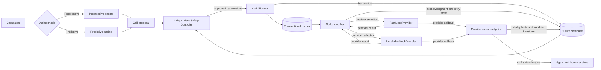
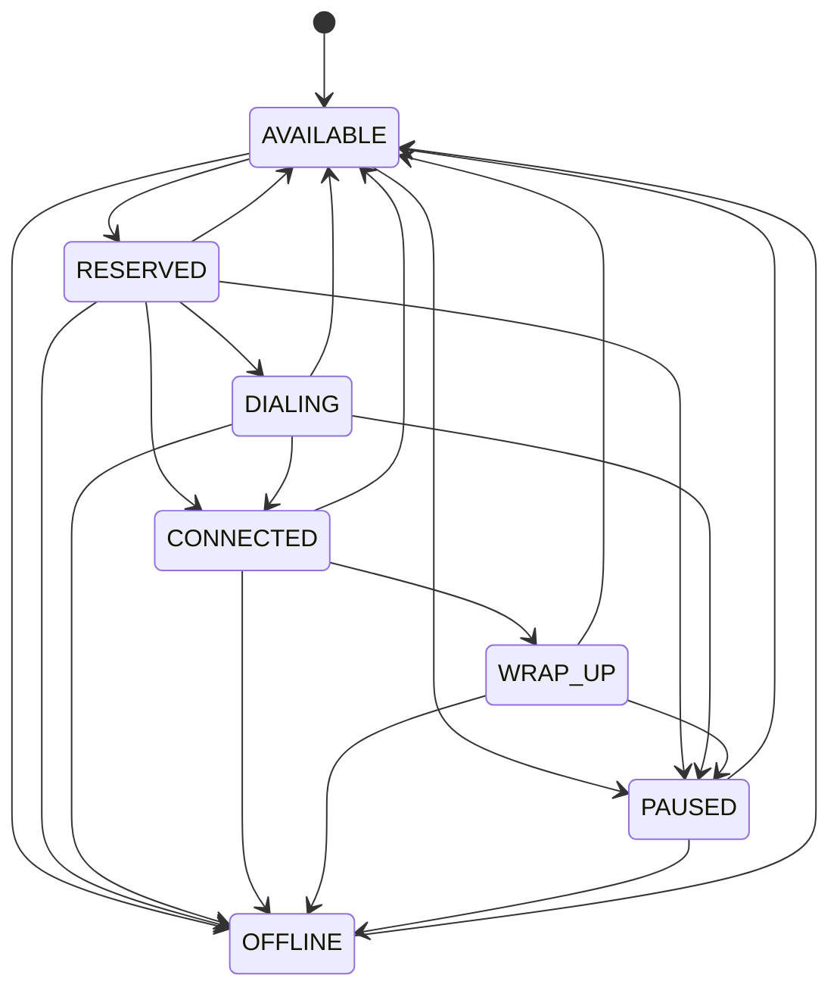
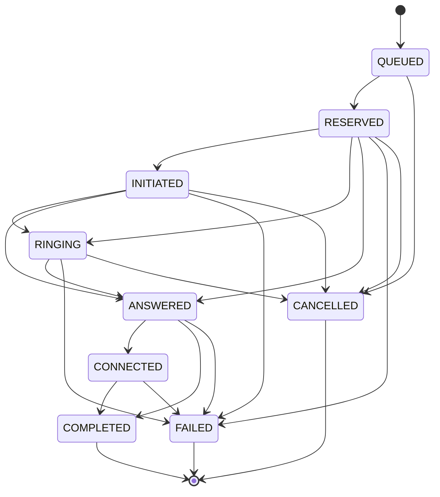

# Architecture and state diagrams

## Component and event flow

Pacing computes a proposal only. The Safety Controller rereads live capacity in the reservation transaction and controls whether the Call Allocator can reserve agents and borrowers. Provider delivery happens after the reservation and outbox transaction commits.

## Agent state machine

## Call state machine

The state diagrams reflect transition tables in `app/services.py`; they do not imply that callbacks without timestamps or sequence numbers can be perfectly ordered.
